# Data Cleaning & Structural Validation | VirtualWorks Task 1

## Executive Summary
This repository contains the completed deliverable for **Task 1: Data Cleaning & Structural Validation** as part of the VirtualWorks Data Analytics Internship. 

The primary objective of this project was to take an unstructured, messy Excel dataset containing duplicate records, invalid calculations, irregular capitalization, inconsistent text delimiters, and missing values, and transform it into a standardized, reliable, and production-ready data asset suitable for downstream analytics and BI dashboarding.

---

## Project Structure
```text
VirtualWorksTask1/
├── data/
│   ├── Raw.xlsx                  # Original unmodified raw dataset
│   └── Data Cleaning.xlsx        # Final cleaned Excel workbook
├── screenshots/                  # Image proofs of cleaning steps
└── Readme.md                     # Project documentation & pipeline breakdown
```

---

## Visual Transformation Overview

| Raw Dataset (Before Cleaning) | Cleaned Dataset (After Cleaning) |
| :---: | :---: |
| 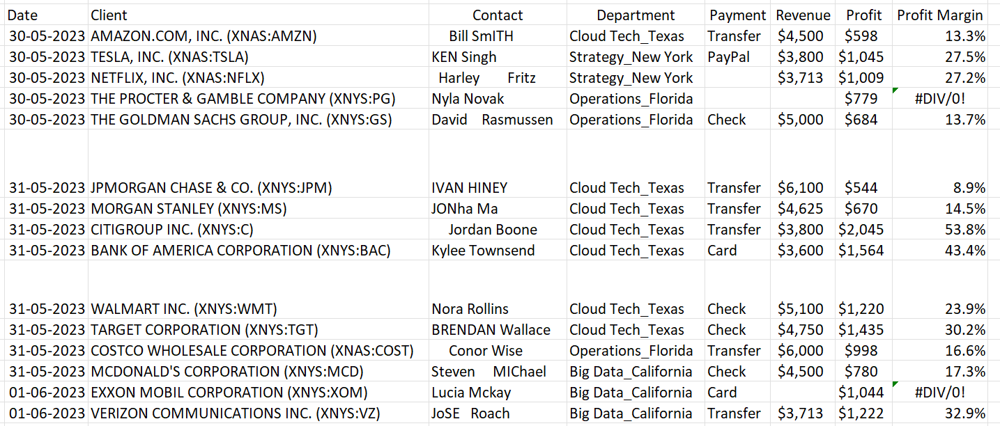 | 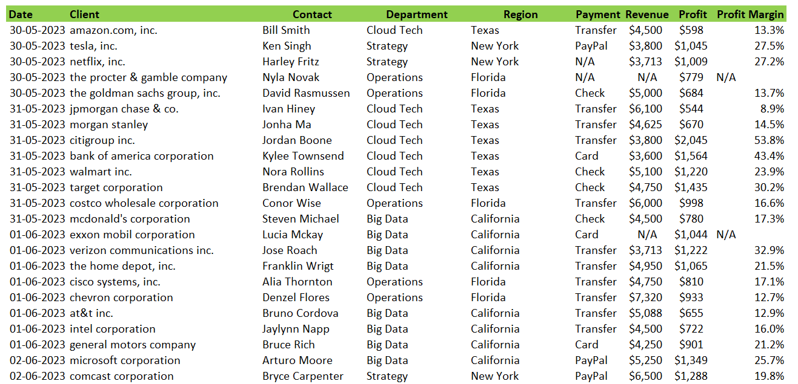 |

---

## Step-by-Step Data Cleaning Pipeline

### Step 1: Gridline Clean-up & Dimension Autofitting
- **Problem:** Text strings overflowed column boundaries and numerical metrics displayed as `######` formatting errors.
- **Solution:** Selected the entire sheet (`Ctrl + A`) and executed Excel's auto-fit commands for both column widths and row heights.
- **Shortcuts Used:** `Alt + H + O + I` (Column Width) | `Alt + H + O + A` (Row Height)

| Before Autofit | After Autofit |
| :---: | :---: |
| 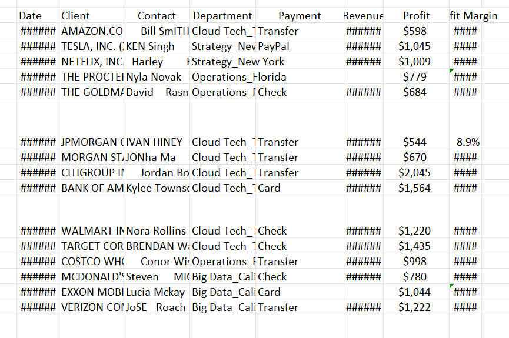 | 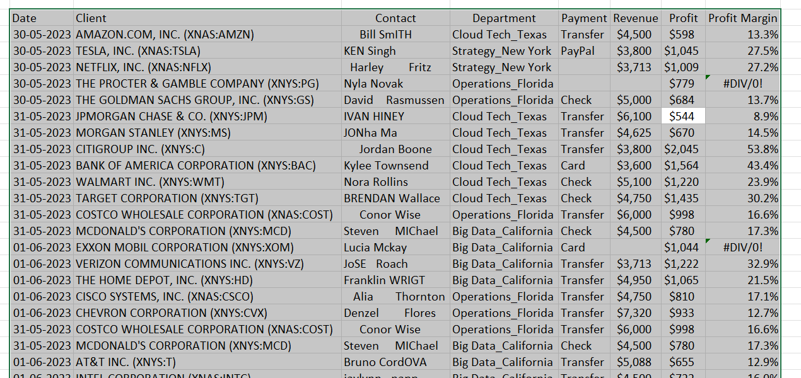 |

---

### Step 2: Removing Stock Tickers & Lowercasing Client Names
- **Problem:** Client names contained extra parenthetical exchange tickers (e.g., `(XNAS:AMZN)`) and inconsistent uppercase formatting.
- **Solution:** 
  1. Used Find & Replace (`Ctrl + H`) with the wildcard search string `(*)` to remove all parenthetical ticker data.
  2. Applied `=LOWER()` in a helper column to standardize all client strings to lowercase.
  3. Replaced formulas with static values via Paste Special (`Alt + H + V + V`).

| Step 2 Summary | Image Proof |
| :--- | :---: |
| **Wildcard Find & Replace Setup (Step 1)** | 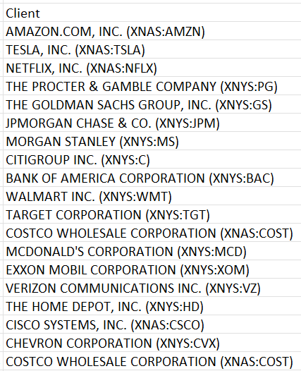 |
| **Wildcard Find & Replace Setup (Step 2)** | 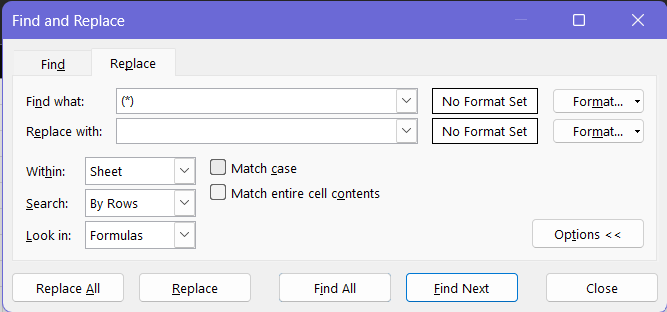 |
| **Lower Function (`=LOWER(C3)`)** |  |
| **Final Lowercased Client Column** |  |

---

### Step 3: Text Normalization (TRIM & PROPER) on Contact Names
- **Problem:** Contact names suffered from trailing spaces, irregular gaps, and mixed casing (e.g., `Bill SmITH`, `Harley   Fritz`).
- **Solution:** Applied a nested text transformation function to strip extra spaces and standardize to Proper Case.
- **Formula:** `=TRIM(PROPER(D3))`

| Before TRIM & PROPER | After TRIM & PROPER |
| :---: | :---: |
| 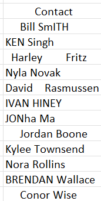 | 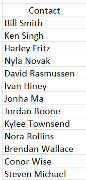 |
| *Formula applied: `=TRIM(PROPER(D3))`* | 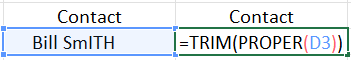 |

---

### Step 4: Text-to-Columns Delimitation (Department & Region)
- **Problem:** `Department` and `Region` were concatenated into a single compound field separated by an underscore (e.g., `Cloud Tech_Texas`).
- **Solution:** Used Excel's **Convert Text to Columns Wizard** with `Other: _` set as the custom delimiter to separate the data into two distinct fields.

| Before Split | Text to Columns Wizard Setup | Processed Department & Region Columns |
| :---: | :---: | :---: |
| 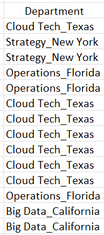 | 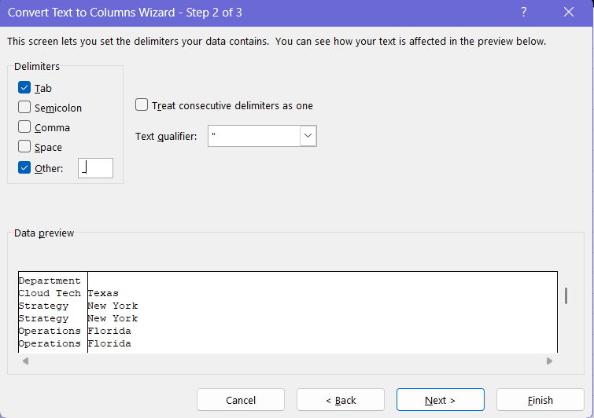 | 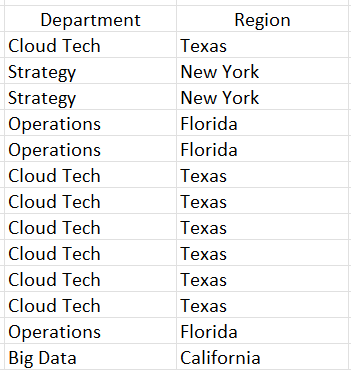 |

---

### Step 5: Handling Missing/Null Values
- **Problem:** The dataset contained blank cells across financial and payment columns, creating data gaps.
- **Solution:** Selected missing cells using `Go To Special > Blanks` (`Ctrl + G`), entered `"N/A"`, and batch-populated all empty fields simultaneously with `Ctrl + Enter`.

| Before Null Population | After Null Population |
| :---: | :---: |
| 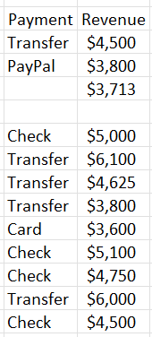 | 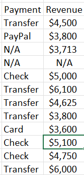 |

---

### Step 6: Defensive Error Handling (Profit Margin Calculation)
- **Problem:** Missing revenue data resulted in standard division formulas returning `#DIV/0!` errors.
- **Solution:** Wrapped the division logic inside an `IFERROR` function to catch division errors and output a clean `"N/A"` string.
- **Formula:** `=IFERROR((I3/H3), "N/A")`

| Profit Margin Column with Errors | IFERROR Formula Implementation Proof |
| :---: | :---: |
| 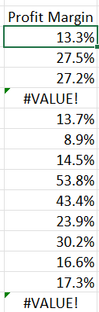 | 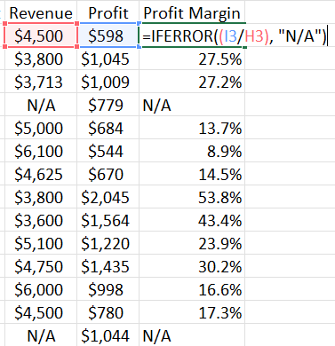 |

---

### Step 7: Deduplication & Final Validation
- **Problem:** Raw dataset contained redundant duplicate records.
- **Solution:** Executed **Remove Duplicates** across all columns to purge duplicate records while preserving data integrity.
- **Result:** **3 duplicate values** were found and removed; **28 unique rows** remained.

| Remove Duplicates Window | Deduplication Result Confirmation |
| :---: | :---: |
| 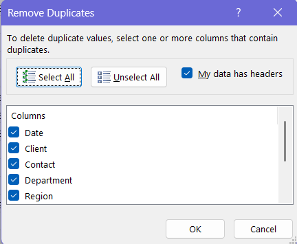 | 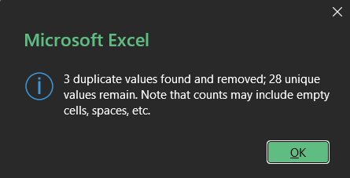 |

---

## Technical Skills & Excel Functions Demonstrated
- **Text Processing:** `=LOWER()`, `=TRIM()`, `=PROPER()`, Text-to-Columns (Underscore Delimiter), Wildcard Find & Replace (`(*)`).
- **Logical & Error Handling:** `=IFERROR()`, `Go To Special > Blanks`.
- **Data Hygiene & Quality Control:** Deduplication, Paste as Values (`Alt + H + V + V`), Autofitting Dimensions (`Alt + H + O + I` / `Alt + H + O + A`).
