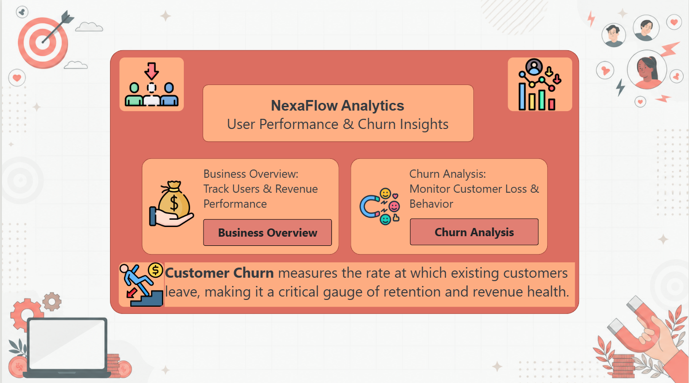
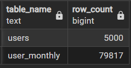
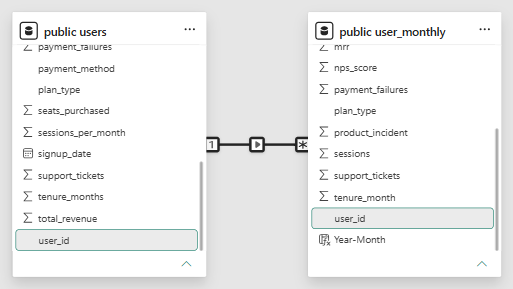
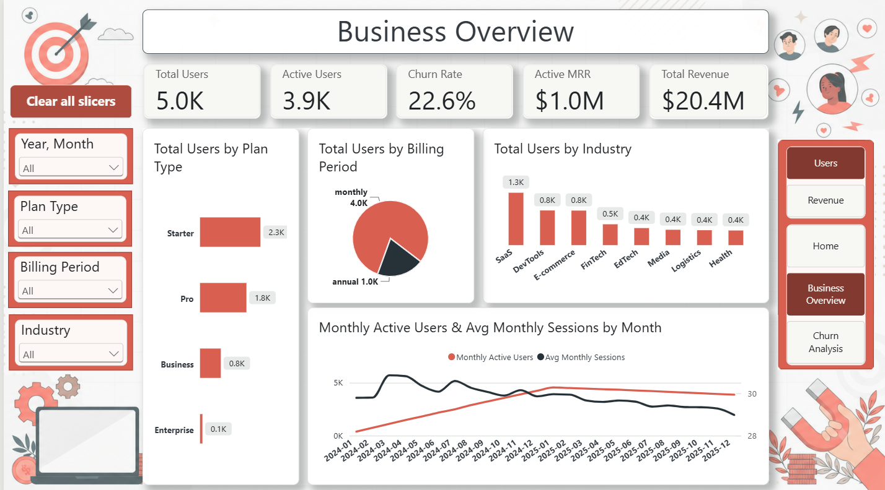
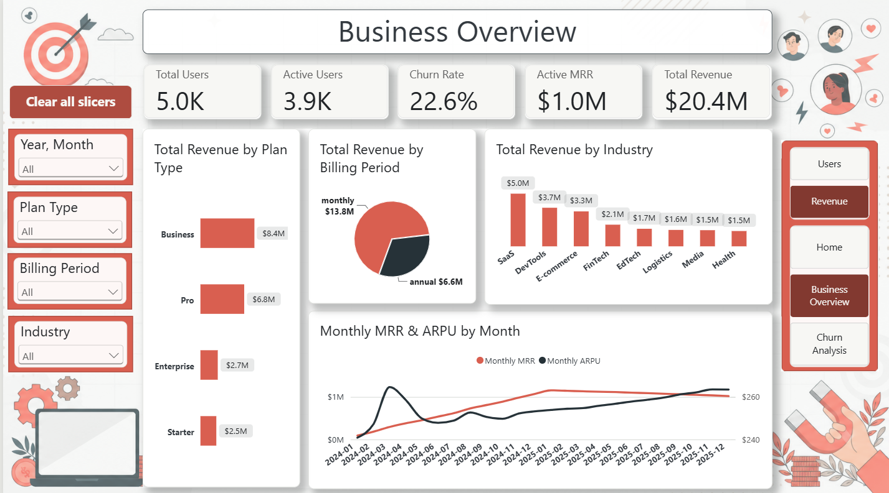
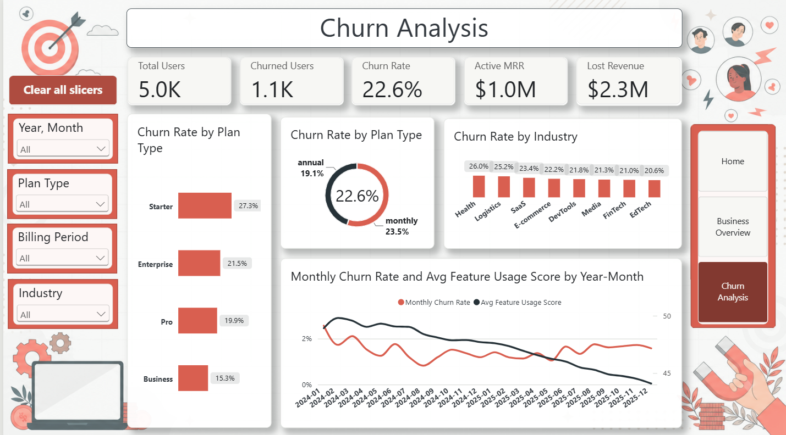

# NexaFlow Analytics — Customer Churn & Revenue Analysis



**[Open Report in Power BI Service](https://app.powerbi.com/groups/me/reports/0dd133e2-7958-4ead-bea5-b62387059d41/b778fd65f4093b5d2868?experience=power-bi)** *(Requires Power BI sign-in — full dashboard screenshots and `.pbix` file are included below)*

---

## Executive Summary

### Business Problem
NexaFlow Analytics lost **1,131 out of 5,000 customers (22.62% churn rate)**, leading to **$2.29M in lost revenue** compared to **$18.08M** from active customers. The company needs to understand *which customers are leaving*, *what warning signs appear before they cancel*, and *where active monthly revenue is most at risk*.

### Methodology
1. **Data Loading:** Loaded the pre-cleaned `users` and `user_monthly` tables (from Hugging Face: `arti199919/synthetic-saas-churn-sample`) into PostgreSQL (`sql/01_data_loading_and_schema.sql`).
2. **Data Cleaning & Checks:** Checked row counts, missing values, duplicates, and table links (`user_id`) to make sure the data was reliable (`sql/02_data_quality_checks.sql`).
3. **SQL Analysis:** Wrote queries to measure churn across plans, billing periods, product usage, customer sentiment (NPS), support tickets, outages, payment failures, and active MRR (`sql/03_churn_analysis_queries.sql`).
4. **Power BI Dashboards:** Built an interactive 3-page Power BI report (`dashboard/NexaFlow_Churn_Analysis.pbix`) covering **Home**, **Business Overview**, and **Churn Analysis**.

### Skills
* **SQL (PostgreSQL):** Creating tables (`PK`/`FK`), loading CSVs, `JOIN`s, CTEs, `CASE WHEN`, subqueries, and window functions.
* **Data Analysis:** Finding churn patterns, spotting early warning signs, and turning numbers into clear business recommendations.
* **Power BI:** Multi-page dashboard design, KPI cards, slicers, and trend charts.

### Results & Business Recommendations
* **Starter & Monthly Users Leave Most Often:** **Starter** plans have the highest churn rate at **27.29%** (634 users), and **monthly** users churn more than **annual** users (**23.50%** vs. **19.15%**). *Recommendation:* Improve Starter onboarding and offer discounts to switch monthly users to annual plans.
* **Usage & Satisfaction Drop Before Cancellation:** One month before churning (`churned_next_month = 1`), average sessions drop from **29.74 to 19.14**, feature usage drops from **46.75 to 27.39**, and NPS drops from **4.68 to 2.70**. *Recommendation:* Set up alerts to reach out to customers when their activity or NPS falls.
* **Support Issues & Failed Payments Trigger Churn:** Product incidents nearly triple next-month churn (**3.54%** vs. **1.28%**), and payment failures push next-month churn from **1.07%** (0 failures) up to **8.57%** (3 failures). *Recommendation:* Add automatic payment retry reminders and follow up quickly after support tickets or outages.
* **Protect Business & Pro Monthly Revenue:** Among active customers, **Business (monthly)** (**$270.1K** MRR) and **Pro (monthly)** (**$251.4K** MRR) make up **$521.4K (51.15%)** of active MRR and can cancel any month. *Recommendation:* Make these two groups the top priority for Customer Success check-ins.

### Next Steps
* Add automated checks to validate new monthly data before updating the dashboard.
* Create a simple churn-risk score combining low usage, high support tickets, and failed payments.

---

## Data Cleaning & Verification

The dataset from Hugging Face was already clean when downloaded, so no heavy raw-data fixes were needed. After loading both files into PostgreSQL, `sql/02_data_quality_checks.sql` verified clean data types, zero duplicate IDs, and matching keys across **5,000 customer accounts** and **79,817 monthly records**.



---

## Data Model Diagram

`users` stores one row per customer (`user_id`), connected one-to-many with `user_monthly`, which tracks each customer's activity and revenue month by month.



---

## Data Dictionary

### Table 1: `users` (Customer Account Details)

| Column | Type | What It Means |
| :--- | :--- | :--- |
| `user_id` | `VARCHAR` | Unique customer ID (Primary Key) |
| `signup_date` | `DATE` | Date the customer signed up |
| `country` | `VARCHAR` | Customer's country |
| `company_size` | `INT` | Number of employees at the customer's company |
| `plan_type` | `VARCHAR` | Subscription plan (`Starter`, `Pro`, `Business`, `Enterprise`) |
| `monthly_price` | `NUMERIC` | Monthly plan price |
| `tenure_months` | `INT` | Total months the customer stayed |
| `total_revenue` | `NUMERIC` | Total revenue earned from the customer |
| `ltv_12m` | `NUMERIC` | Expected 12-month customer value |
| `industry` | `VARCHAR` | Customer's business industry |
| `acquisition_channel` | `VARCHAR` | How the customer found the product (`organic`, `paid`, etc.) |
| `billing_period` | `VARCHAR` | How they pay (`monthly` or `annual`) |
| `seats_purchased` | `INT` | Number of user seats bought |
| `discount_pct` | `NUMERIC` | Discount percentage applied |
| `payment_method` | `VARCHAR` | Payment type (`card` or `invoice`) |
| `churned` | `INT` | `1` = cancelled, `0` = still active |

### Table 2: `user_monthly` (Monthly Customer Activity)

| Column | Type | What It Means |
| :--- | :--- | :--- |
| `user_id` | `VARCHAR` | Customer ID linking back to `users` |
| `month` | `DATE` | Month of the snapshot |
| `tenure_month` | `INT` | Which month of their lifecycle this is |
| `mrr` | `NUMERIC` | Monthly Recurring Revenue in that month |
| `sessions` | `INT` | Number of logins/sessions in that month |
| `feature_usage_score` | `NUMERIC` | Score showing how much they used product features |
| `support_tickets` | `INT` | Number of support tickets opened |
| `payment_failures` | `INT` | Number of failed payments |
| `nps_score` | `INT` | Customer satisfaction rating (NPS) |
| `product_incident` | `INT` | `1` = experienced a product issue/outage, `0` = none |
| `active_seats` | `INT` | Seats actively used that month |
| `churned` | `INT` | `1` = cancelled this month, `0` = stayed |
| `churned_next_month` | `INT` | `1` = cancelled the following month, `0` = stayed |

---

## Data Storytelling, Sample SQL & Query Results

### Sample SQL Queries (What I Did & Why)

```sql
-- WHY: Check if customer activity and satisfaction drop one month before they cancel.
-- WHAT: Compares average sessions, feature usage, and NPS for users about to churn vs. active users.
SELECT
    um.churned_next_month,
    COUNT(*) AS user_months,
    ROUND(AVG(um.sessions), 2) AS avg_sessions,
    ROUND(AVG(um.feature_usage_score), 2) AS avg_feature_usage_score,
    ROUND(AVG(um.nps_score), 2) AS avg_nps_score
FROM users u
INNER JOIN user_monthly um ON u.user_id = um.user_id
GROUP BY um.churned_next_month
ORDER BY um.churned_next_month DESC;

-- WHY: Find out which active plans hold the most recurring revenue without annual lock-in.
-- WHAT: Sums latest-month MRR and share of active MRR across non-churned users.
SELECT
    u.plan_type,
    u.billing_period,
    COUNT(DISTINCT u.user_id) AS active_users,
    ROUND(SUM(um.mrr), 2) AS total_mrr,
    ROUND(100.0 * SUM(um.mrr) / SUM(SUM(um.mrr)) OVER (), 2) AS pct_of_active_mrr
FROM users u
JOIN user_monthly um ON u.user_id = um.user_id
WHERE u.churned = 0
  AND um.month = (SELECT MAX(month) FROM user_monthly)
GROUP BY u.plan_type, u.billing_period
ORDER BY total_mrr DESC;
```

### Query Results & Insights

**1. Overall Churn & Revenue Impact**
* **Total Customers:** 5,000 (**3,869 active** vs. **1,131 churned** — **22.62% churn rate**)
* **Revenue Comparison:** Churned users generated **$2.29M** (`$1,643` avg 12-month LTV), while active users generated **$18.08M** (`$3,162` avg 12-month LTV).

**2. Churn by Plan & Billing Period**

| Category | Segment | Churned Users | Churn Rate |
| :--- | :--- | :---: | :---: |
| **Plan Type** | Starter | 634 | 27.29% |
| **Plan Type** | Enterprise | 20 | 21.51% |
| **Plan Type** | Pro | 355 | 19.90% |
| **Plan Type** | Business | 122 | 15.25% |
| **Billing** | Monthly | 938 | 23.50% |
| **Billing** | Annual | 193 | 19.15% |

**3. Warning Signs One Month Before Churn**

| Customer Status | Months Tracked | Avg Sessions | Avg Feature Usage | Avg NPS Score |
| :--- | :---: | :---: | :---: | :---: |
| **About to Churn (`churned_next_month = 1`)** | 1,056 | 19.14 | 27.39 | 2.70 |
| **Staying Active (`churned_next_month = 0`)** | 78,761 | 29.74 | 46.75 | 4.68 |

**4. Friction Impact (Support, Incidents & Failed Payments)**
* **Product Outages:** Next-month churn jumps from **1.28%** (no incident) to **3.54%** when a customer hits a product incident.
* **Support Tickets:** Next-month churn climbs steadily as tickets rise—from **0.65%** (0 tickets) to **3.11%** (3 tickets) and **5.24%** (5 tickets).
* **Payment Failures:** Next-month churn rises from **1.07%** (0 failures) to **2.70%** (1 failure), **4.19%** (2 failures), and **8.57%** (3 failures).

**5. Where Active Monthly Revenue (MRR) Is Concentrated**

| Plan & Billing Period | Active Users | Active MRR | Share of Active MRR |
| :--- | :---: | :---: | :---: |
| **Business \| monthly** | 485 | $270,066.95 | 26.49% |
| **Pro \| monthly** | 1,122 | $251,377.45 | 24.66% |
| **Business \| annual** | 193 | $158,630.72 | 15.56% |
| **Starter \| monthly** | 1,404 | $95,224.64 | 9.34% |
| **Pro \| annual** | 307 | $88,978.42 | 8.73% |
| **Enterprise \| annual** | 30 | $69,112.23 | 6.78% |
| **Enterprise \| monthly** | 43 | $63,994.72 | 6.28% |
| **Starter \| annual** | 285 | $22,049.58 | 2.16% |

*(See `docs/query_results_summary.md` for all 13 query tables including industry, acquisition channel, and seat usage.)*

---

## Power BI Dashboards

| Business Overview (Users) | Business Overview (Revenue) | Churn Analysis |
| :---: | :---: | :---: |
|  |  |  |

---

## Project Files

* `sql/01_data_loading_and_schema.sql` — Creates database tables and loads the CSVs
* `sql/02_data_quality_checks.sql` — Checks row counts, nulls, and table relationships
* `sql/03_churn_analysis_queries.sql` — All 13 commented SQL queries with saved outputs
* `docs/data_dictionary.md` — Detailed column definitions
* `docs/query_results_summary.md` — Full query output tables
* `dashboard/NexaFlow_Churn_Analysis.pbix` — Interactive Power BI dashboard file